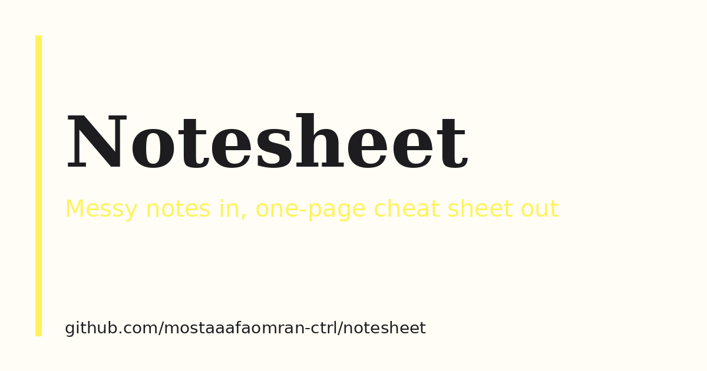

# Notesheet

Messy notes in, one-page cheat sheet out.

 

**Live demo:** https://mostaaafaomran-ctrl.github.io/notesheet/ (add `?demo=1` to see it filled with sample data)

Turn messy notes into a clean printable cheat sheet in 1-3 columns. Print to PDF. Arabic + English, offline.

## Features

- Headings, bullets, **bold**, ==highlight== and `code`
- 1, 2 or 3 columns and three text sizes
- Print to A4 PDF straight from the browser
- Mixed Arabic and English lines align automatically
- Saved on your device only

## Run it locally

It is one `index.html` file. Open it in a browser. No build step, no dependencies, no server.

## Privacy

Everything runs in your browser. Nothing is uploaded. Data you enter is kept in your browser's local storage on your device only.

## بالعربي

حوّل ملاحظاتك المبعثرة لملخص مطبوع في صفحة واحدة، بأعمدة وخط تختاره. يدعم العربي.

افتح الملف `index.html` في المتصفح وهيشتغل على طول، من غير تسجيل ومن غير سيرفر.

## License

MIT
